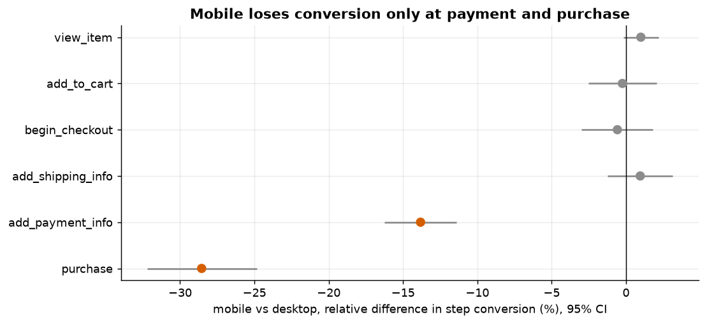
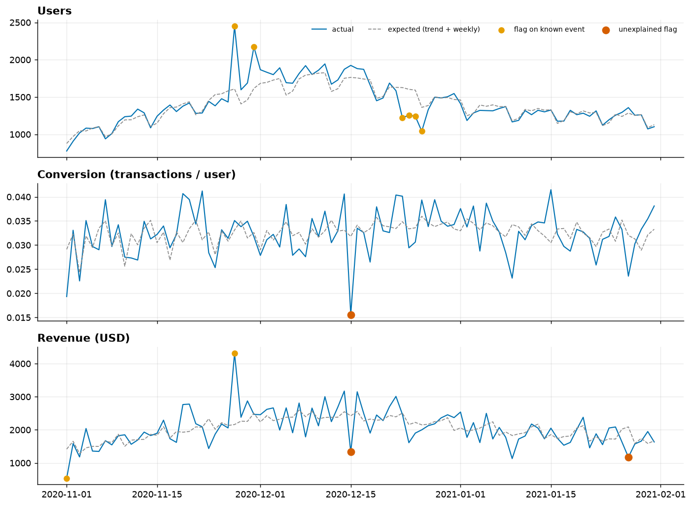
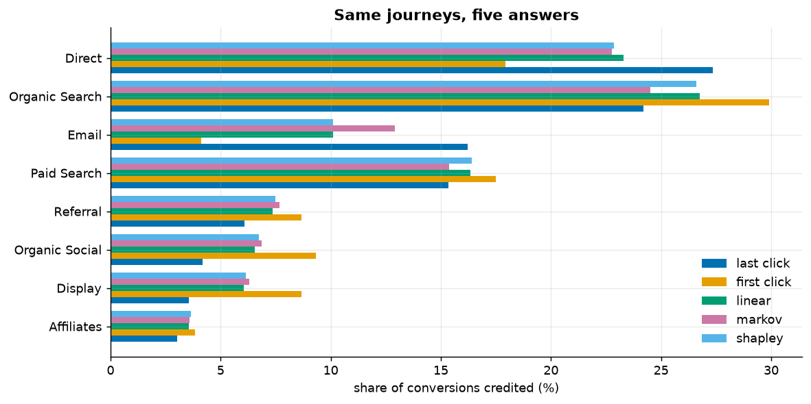
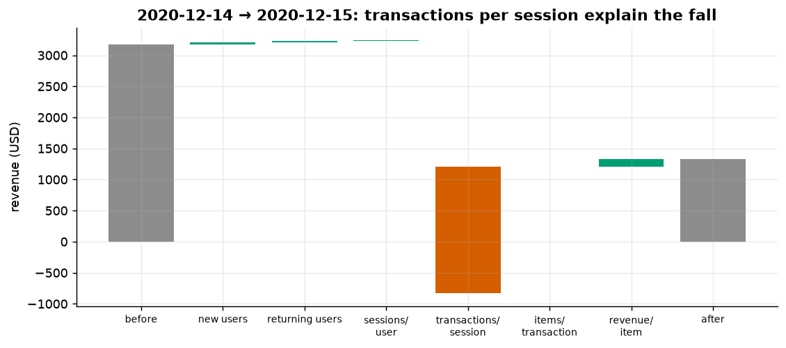

# Stakeholder readout: improving ecommerce conversion

**Scope:** Nov 1, 2020 to Jan 31, 2021 · 80,000 users · 139,187 sessions · 4,218 orders · $189,306 revenue
**Data:** a synthetic dataset with the GA4 BigQuery export schema (see [DATA.md](DATA.md)). Absolute
numbers are illustrative; the relative findings are validated against effects planted in the data.

---

## The short version

1. **Mobile checkout is the biggest fixable leak.** Mobile is 41% of sessions but converts 38% worse
   than desktop, and the entire gap sits at the last two checkout steps. Closing it is worth up to
   **+736 orders and about $33k (+17% revenue)** over the period.
2. **A one-day mobile payment outage on Dec 15 went unnoticed by revenue reporting.** Mobile
   checkout success fell from 50% to 6% while traffic was normal. Revenue alone barely crossed the
   alert threshold.
3. **Last-click reporting undervalues Display and Organic Social by about 40%.** They open
   journeys that Email and Direct close. Cutting them on last-click numbers would shrink the top of
   the funnel.
4. **Traffic, not conversion, drove the season.** Black Friday doubled revenue through visitors, and
   January fell 26% through visitors. Site conversion held steady apart from the outage.

---

## 1. Mobile checkout: where the conversion goes

| Step (conversion from previous step) | Mobile | Desktop | Gap |
|---|---|---|---|
| View item | 45.7% | 45.2% | not significant |
| Add to cart | 32.8% | 32.9% | not significant |
| Begin checkout | 57.2% | 57.5% | not significant |
| Add shipping info | 74.4% | 73.7% | not significant |
| **Add payment info** | **67.5%** | **78.3%** | **−14%** (p < 0.001) |
| **Purchase** | **47.9%** | **67.0%** | **−29%** (p < 0.001) |

Mobile shoppers browse, add to cart and start checkout exactly like desktop shoppers. They drop out
when entering payment details and again when submitting the order. That's a payment-form problem,
not a traffic-quality problem.

**Sizing:** if mobile matched desktop at those two steps, mobile orders would rise from 1,179 to
1,915: **+736 orders, about $33k at the $44.88 AOV, or 17% of period revenue.** Recovering half the gap
is about $16.5k. Treat these as upper bounds: some of the gap is inherent to small screens.

**Recommendations**
- **Wallet payments first** (Apple Pay / Google Pay) on mobile, to remove card entry, the step with
  the biggest drop.
- **Audit the mobile payment form:** field count, input types (numeric keypad for card numbers),
  autofill, inline validation and error messages, and the 3-D Secure flow on small screens.
- **Instrument the payment step:** log submit errors and payment-provider responses as GA4 events, so
  the next analysis can say *why* orders fail, not just where.
- **A/B test each change** on mobile, with purchase given `add_payment_info` as the primary metric.
  At the current volume, a 50/50 test over a quarter (about 2,500 mobile sessions reach payment) can
  detect a 12% relative change in checkout success (80% power, α = 0.05). That's well inside the
  29% gap to desktop. Overall conversion is a noisier metric: it needs a 16% change to register.

## 2. The Dec 15 payment outage

On Dec 15, conversion, transactions, revenue and checkout completion all fired as anomalies at once,
and traffic was normal. The drill-down:

- **Mobile:** 2 orders from 835 sessions against about 19 expected. Checkout success (purchase given
  payment info) fell from 50% to 6%. Every earlier step was normal.
- **Tablet:** 0 orders against 2 expected. iOS and Android both collapsed.
- **Desktop and all marketing channels:** no concentrated failure.

That points to the mobile payment path, most likely at the payment provider. Cost: about 19 orders
and about $1,100 of revenue during peak pre-Christmas trading, plus customers who failed at payment
and may not come back.

**Recommendations**
- **Alert on checkout success by device**, not only on revenue. Revenue reached z = −4.1 on the day,
  while mobile checkout success fell 88%.
- **Run a synthetic mobile checkout** against the payment provider every hour in production.
- **Keep a calendar of known events** (Black Friday, Christmas) in the alerting. Seven of the nine
  alarm days in the period were calendar events that no one needs to investigate.

## 3. Marketing: credit the channels that start journeys

| Channel | Last-click | First-click | Markov (recommended) |
|---|---|---|---|
| Display | 3.6% | 8.7% | 6.3% |
| Organic Social | 4.2% | 9.3% | 6.9% |
| Email | 16.2% | 4.1% | 12.9% |
| Direct | 27.4% | 17.9% | 22.8% |

More than half of conversions (53%) involve several visits. Display and Organic Social are usually
the first touch; Email and Direct are usually the last. Each model answers a different question, so
they disagree. Sampling noise is only about ±1 point, so more data won't close the gap.

**Recommendations**
- **Report Markov attribution as the default** and show last- and first-click beside it as bounds.
  Don't cut Display or Organic Social on last-click numbers.
- **Treat Email as a closer:** its last-click credit (16%) overstates its share of the journey.
- **Run a geo holdout or conversion-lift test before moving budget.** None of these models are
  causal; they split observed conversions.
- **Fix acquisition-channel reporting** to use the session's source/medium, not GA4's user-level
  `traffic_source`. The latter credits every session to the user's *first* channel: Email loses 79%
  of its sessions and Display gains 32%.

## 4. What drove revenue day to day

Revenue = visitors × conversion × order value. Splitting each day's change across those factors:

- **Black Friday:** revenue +110%, 73% of it from visitors.
- **Dec 15:** revenue −58%, entirely from conversion (transactions per session −62%). Visitors were
  +3% and order value +6%.
- **January vs early December:** revenue −26%, almost all from visitors. Conversion and order value
  held.

**Recommendations**
- **January is an acquisition problem, not a site problem.** Put post-holiday budget into
  re-engaging December buyers (Email) and prospecting, not into site changes.
- **Don't act on single-day moves.** At about 45 orders a day, most day-to-day swings in conversion
  and order value are noise. Use the anomaly detector to decide what's worth explaining.

## 5. Other conversion levers

- **Top-of-funnel engagement by channel:** add-to-cart from product views is 44% for Email and 37% for
  Direct, against 20% for Display and 21% for Organic Social. For prospecting traffic, test landing
  pages built around a product rather than the home page.
- **Returning visitors add to cart 38% more often** than new ones, so retargeting and saved carts
  for first-time visitors are worth testing.

## How confident are we?

| Finding | Confidence | Why |
|---|---|---|
| Mobile payment and purchase gap | High | 57k mobile sessions; p < 0.001 at both steps; nothing upstream |
| Dec 15 outage | High | Four KPIs at once; isolated to one step on mobile and tablet |
| Channel roles (openers vs closers) | High | Consistent across models; tight bootstrap intervals |
| Exact attribution shares | Medium | Model-dependent by design; needs an experiment for causal answers |
| Tablet differences | Low | 4k sessions; can only detect a gap of about 26% |

**Data caveats** (details in [DATA_QUALITY.md](DATA_QUALITY.md)):
- About 5% of users have placeholder acquisition data.
- 8% of orders have no transaction id.
- Cookie-based ids split cross-device journeys, which under-credits channels that start them.
- The three-month window cuts journeys at both ends.

## Next steps

| # | Action | Owner | Metric |
|---|---|---|---|
| 1 | Mobile wallet payments + payment-form audit, A/B tested | Product / Engineering | Mobile purchase given `add_payment_info` |
| 2 | Device-level checkout-success alert + hourly synthetic checkout | Engineering / SRE | Time to detect a checkout failure |
| 3 | Switch channel reporting to Markov on session source/medium | Analytics | Adoption in the weekly report |
| 4 | Geo holdout for Display and Organic Social | Marketing | Incremental conversions |
| 5 | Log payment errors as GA4 events | Engineering | Share of failed payments with a reason |
